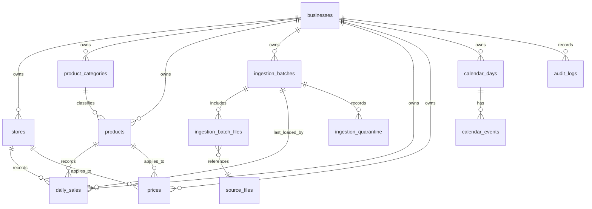

# DemandPilot AI database schema proposal

**Status: PROPOSED — approval required before any migration or DDL.**
This document is a design only. No database objects have been created.

## 1. Scope and assumptions

The initial schema supports M5 ingestion and later forecasting while separating tenants. M5 is represented as one `business` record with Walmart-style stores, products and categories. The real files are available in `data/raw/m5/`; database integration must use a dedicated disposable test database, never a development or personal database. PostgreSQL is available locally, but this design does not assume credentials or create a database.

M5 sales files contain nonnegative observed unit sales, not unconstrained demand. Inventory/stockout information is absent. Forecast evaluations must therefore be described as predictions of observed sales. A corrected M5 delivery replaces the current canonical value for its natural key, while the original file is retained by its immutable checksum reference and the correction is recorded in the audit log.

## 2. Entity relationship

Every tenant-owned table carries `business_id`. Child-to-parent foreign keys include `(business_id, parent_id)` so a row cannot reference another tenant's store, product, batch, calendar day, or source file. Repository methods must require and filter by `business_id`; PostgreSQL row-level security is a later defense-in-depth option, not a substitute for scoped repositories. The `businesses` row is the tenant root and therefore has no `business_id` column of its own.

## 3. Core tables and columns

Types below are PostgreSQL types. All primary identifiers use UUIDs generated by the application. Mutable tables have `created_at timestamptz NOT NULL` and `updated_at timestamptz NOT NULL`, both UTC; immutable event/source tables have `created_at` only. Business dates use `date`, never timestamps. All tables use `created_at` defaults set by the database/application to `now()`; services must supply UTC-aware values and never store local wall-clock timestamps in `timestamptz`.

### `businesses` — tenant root

- `id uuid PRIMARY KEY`
- `slug text NOT NULL UNIQUE` — stable tenant key
- `name text NOT NULL`
- `timezone text NOT NULL` — IANA timezone for business-local dates
- `status text NOT NULL CHECK (status IN ('ACTIVE','SUSPENDED'))`
- `created_at timestamptz NOT NULL`, `updated_at timestamptz NOT NULL`

Index: unique `slug`. Do not store credentials or secrets here.

### `stores` — tenant stores

- `id uuid PRIMARY KEY`, `business_id uuid NOT NULL REFERENCES businesses(id)`
- `store_code text NOT NULL`, `name text`, `state_code text`, `timezone text NOT NULL`
- `created_at timestamptz NOT NULL`, `updated_at timestamptz NOT NULL`
- `UNIQUE (business_id, id)` for composite tenant foreign keys
- `UNIQUE (business_id, store_code)`

Index: `(business_id, state_code, store_code)` for scoped store selection.

### `product_categories` — tenant category hierarchy

- `id uuid PRIMARY KEY`, `business_id uuid NOT NULL REFERENCES businesses(id)`
- `parent_category_id uuid NULL`, `category_code text NOT NULL`, `name text NOT NULL`, `level smallint NOT NULL CHECK (level >= 0)`
- `created_at timestamptz NOT NULL`, `updated_at timestamptz NOT NULL`
- `UNIQUE (business_id, id)`, `UNIQUE (business_id, category_code)`
- Composite self-reference `(business_id, parent_category_id) -> product_categories(business_id, id)`

Index: `(business_id, parent_category_id)`.

### `products` — tenant products

- `id uuid PRIMARY KEY`, `business_id uuid NOT NULL REFERENCES businesses(id)`
- `category_id uuid NOT NULL`, `item_code text NOT NULL`, `name text`, `department_code text`, `unit_of_measure text NOT NULL`, `pack_size numeric(18,4) NOT NULL DEFAULT 1 CHECK (pack_size > 0)`
- `created_at timestamptz NOT NULL`, `updated_at timestamptz NOT NULL`
- `UNIQUE (business_id, id)`, `UNIQUE (business_id, item_code)`
- Composite FK `(business_id, category_id) -> product_categories(business_id, id)`

Index: `(business_id, category_id, item_code)`.

### `source_files` — immutable source-file checksum registry

This is the accepted checksum-level reference instead of copying large raw CSV rows into the database. Original files remain immutable external inputs; the checksum makes each delivery identifiable.

- `id uuid PRIMARY KEY`, `business_id uuid NOT NULL REFERENCES businesses(id)`
- `source_name text NOT NULL`, `file_name text NOT NULL`, `source_uri text NOT NULL` — local path/URI without credentials
- `sha256 char(64) NOT NULL CHECK (sha256 ~ '^[0-9a-f]{64}$')`
- `size_bytes bigint NOT NULL CHECK (size_bytes >= 0)`, `detected_format text NOT NULL`
- `created_at timestamptz NOT NULL`
- `UNIQUE (business_id, id)`, `UNIQUE (business_id, source_name, file_name, sha256)`

Index: `(business_id, source_name, file_name)`; files are not updated in place. A changed hash creates a new row.

### `ingestion_batches` — one logical import attempt

- `id uuid PRIMARY KEY`, `business_id uuid NOT NULL REFERENCES businesses(id)`
- `source_name text NOT NULL`, `idempotency_key text NOT NULL` — stable content/config key for the logical import
- `status text NOT NULL CHECK (status IN ('RUNNING','SUCCEEDED','PARTIAL','FAILED'))`
- `started_at timestamptz NOT NULL`, `finished_at timestamptz NULL`
- `rows_read bigint NOT NULL DEFAULT 0 CHECK (rows_read >= 0)`, `rows_loaded bigint NOT NULL DEFAULT 0 CHECK (rows_loaded >= 0)`, `rows_quarantined bigint NOT NULL DEFAULT 0 CHECK (rows_quarantined >= 0)`, `duplicate_rows bigint NOT NULL DEFAULT 0 CHECK (duplicate_rows >= 0)`
- `error_code text NULL`, `error_message text NULL` — sanitized, no credentials
- `created_at timestamptz NOT NULL`, `updated_at timestamptz NOT NULL`
- `UNIQUE (business_id, id)`, `UNIQUE (business_id, source_name, idempotency_key)`
- Check: `finished_at IS NULL OR finished_at >= started_at`; terminal status iff `finished_at IS NOT NULL`.

Index: `(business_id, status, started_at DESC)`.

### `ingestion_batch_files` — batch inputs

- `business_id uuid NOT NULL`, `batch_id uuid NOT NULL`, `source_file_id uuid NOT NULL`
- `role text NOT NULL` — for example `sales`, `calendar`, `prices`
- `created_at timestamptz NOT NULL`
- `PRIMARY KEY (business_id, batch_id, source_file_id)`
- Composite FKs to `ingestion_batches(business_id,id)` and `source_files(business_id,id)`

Index: `(business_id, source_file_id)`.

### `daily_sales` — validated current daily values

- `id uuid PRIMARY KEY`, `business_id uuid NOT NULL`, `store_id uuid NOT NULL`, `product_id uuid NOT NULL`
- `sales_date date NOT NULL` — business-local calendar date
- `source_name text NOT NULL`
- `units numeric(18,4) NULL CHECK (units IS NULL OR units >= 0)` — units sold; returns/cancellations are separate measures, never encoded as negative sales
- `returns_units numeric(18,4) NOT NULL DEFAULT 0 CHECK (returns_units >= 0)`
- `data_status text NOT NULL CHECK (data_status IN ('OBSERVED','ZERO_CONFIRMED','MISSING','NOT_AVAILABLE','IMPUTED'))`
- `ingestion_batch_id uuid NOT NULL`, `source_file_id uuid NOT NULL`
- `created_at timestamptz NOT NULL`, `updated_at timestamptz NOT NULL`
- Status/value constraint: `OBSERVED` requires `units > 0`; `ZERO_CONFIRMED` requires `units = 0`; `MISSING` and `NOT_AVAILABLE` require `units IS NULL`; `IMPUTED` requires `units >= 0`.
- `UNIQUE (business_id, store_id, product_id, sales_date, source_name)` — canonical current row per tenant/store/product/day/source
- Composite FKs to tenant-scoped stores, products, batches and source files

Indexes: unique natural key above; `(business_id, sales_date, store_id)` for date-range reads; `(business_id, product_id, sales_date)` for series history; `(business_id, ingestion_batch_id)` for batch reconciliation. Range partitioning is deferred until measured row counts and query plans justify it.

### `prices` — effective-dated unit prices

- `id uuid PRIMARY KEY`, `business_id uuid NOT NULL`, `store_id uuid NOT NULL`, `product_id uuid NOT NULL`
- `valid_from date NOT NULL`, `valid_to date NULL` — half-open interval `[valid_from, valid_to)`; null means open-ended
- `unit_price numeric(18,4) NOT NULL CHECK (unit_price > 0)`, `currency char(3) NOT NULL`
- `source_name text NOT NULL`, `source_file_id uuid NOT NULL`, `ingestion_batch_id uuid NOT NULL`
- `created_at timestamptz NOT NULL`, `updated_at timestamptz NOT NULL`
- Check: `valid_to IS NULL OR valid_to > valid_from`
- `UNIQUE (business_id, store_id, product_id, source_name, valid_from)`
- Composite tenant FKs to stores, products, source files and batch

Indexes: `(business_id, store_id, product_id, valid_from DESC)` and `(business_id, valid_to)`. The initial repository validates that effective intervals for the same source/store/product do not overlap; exclusion constraints are deferred to avoid requiring `btree_gist` before needed.

### `calendar_days` — business calendar date and known flags

- `id uuid PRIMARY KEY`, `business_id uuid NOT NULL REFERENCES businesses(id)`
- `calendar_date date NOT NULL`, `region_code text NOT NULL DEFAULT '*'`
- `weekday_name text NOT NULL`, `weekday_number smallint NOT NULL CHECK (weekday_number BETWEEN 1 AND 7)`, `month_number smallint NOT NULL CHECK (month_number BETWEEN 1 AND 12)`, `year_number smallint NOT NULL`
- `snap_by_region jsonb NOT NULL DEFAULT '{}'::jsonb` — region-to-boolean flags known for that date
- `source_file_id uuid NULL`, `ingestion_batch_id uuid NULL`
- `created_at timestamptz NOT NULL`, `updated_at timestamptz NOT NULL`
- `UNIQUE (business_id, id)`, `UNIQUE (business_id, calendar_date, region_code)`
- Composite nullable FKs to batch/source file

Index: `(business_id, calendar_date)`.

### `calendar_events` — dated event facts

- `id uuid PRIMARY KEY`, `business_id uuid NOT NULL`, `calendar_day_id uuid NOT NULL`
- `region_code text NOT NULL DEFAULT '*'`, `event_name text NOT NULL`, `event_type text NOT NULL`, `event_slot smallint NOT NULL DEFAULT 1 CHECK (event_slot > 0)`
- `source_file_id uuid NULL`, `created_at timestamptz NOT NULL`
- Composite FK `(business_id, calendar_day_id) -> calendar_days(business_id,id)` and nullable source-file FK
- `UNIQUE (business_id, calendar_day_id, region_code, event_slot, event_type)`

Index: `(business_id, region_code, event_type, calendar_day_id)`.

### `ingestion_quarantine` — rejected source rows and diagnostics

- `id uuid PRIMARY KEY`, `business_id uuid NOT NULL`, `ingestion_batch_id uuid NOT NULL`, `source_file_id uuid NOT NULL`
- `source_row_number bigint NOT NULL CHECK (source_row_number > 0)`, `row_key text NULL`
- `reason_code text NOT NULL`, `reason_detail text NOT NULL`, `raw_payload jsonb NOT NULL`
- `created_at timestamptz NOT NULL`
- Composite tenant FKs to batch and source file
- `UNIQUE (business_id, ingestion_batch_id, source_file_id, source_row_number, reason_code)`

Index: `(business_id, ingestion_batch_id, reason_code)`.

### `audit_logs` — durable business audit events

- `id uuid PRIMARY KEY`, `business_id uuid NOT NULL REFERENCES businesses(id)`
- `actor_type text NOT NULL CHECK (actor_type IN ('SYSTEM','USER','SERVICE'))`, `actor_ref text NULL`
- `action text NOT NULL`, `entity_type text NOT NULL`, `entity_id uuid NULL`
- `occurred_at timestamptz NOT NULL`, `correlation_id uuid NULL`
- `before_state jsonb NULL`, `after_state jsonb NULL`, `details jsonb NOT NULL DEFAULT '{}'::jsonb`

Indexes: `(business_id, occurred_at DESC)`, `(business_id, entity_type, entity_id)`, `(business_id, action, occurred_at DESC)`. Audit rows are append-only; secrets and credentials are prohibited from payloads.

## 4. Later tables: names and purposes only

These are not part of the initial migration unless separately approved: `inventory_snapshots` (on-hand/inbound state at an as-of date), `inventory_movements` (receipts, sales, adjustments), `product_suppliers` (effective-dated supplier lead time, MOQ, pack multiple and cost), `feature_snapshots` (origin-scoped feature inputs and provenance), `model_runs` (training/evaluation run metadata), `model_versions` (immutable model identity and lifecycle state), `forecasts` (append-only point/interval forecasts), `forecast_actuals` (later observed outcomes linked to forecasts), `model_evaluation_metrics` (metric value, validity and sample size), `backtest_runs` (schedule/configuration and status), `recommendations` (proposed action and evidence), `recommendation_status_history` (actor and state transition), `recommendation_feedback` (manager response/reason), and `business_action_outcomes` (separately measured executed-action outcomes). Each business-owned later table will include `business_id`; forecast-related DDL requires a separate review if not included in the approved M3 schema.

## 5. Tenant isolation

- Every business-owned table above includes non-null `business_id`, except `businesses`, the tenant root.
- Parent tables expose `UNIQUE (business_id,id)`. Child FKs include both tenant and parent identifier, preventing accidental cross-tenant links at the database layer.
- Every repository constructor/method takes `business_id`; every select, update, delete, and upsert predicate includes it. No public repository accepts an unscoped entity ID alone.
- Tests will create two businesses and prove reads/writes remain scoped. RLS is deferred until connection-pool tenant context and operational policy are designed; it can be added as defense in depth.

## 6. Idempotency, corrected deliveries, and audit behavior

- A logical import key is `(business_id, source_name, subset/config fingerprint, source-file SHA-256 set)`. The same key returns the existing terminal batch and performs no writes on re-run.
- `source_files` is immutable and unique by tenant/source/file/hash. A changed file hash creates a new source-file record and a new batch.
- `daily_sales` natural key is `(business_id, store_id, product_id, sales_date, source_name)`. For the first accepted value, insert. On a later corrected delivery, update the canonical row only when the incoming validated value/status differs; update its latest batch/file references and `updated_at`, and append an `audit_logs` correction event containing old/new non-sensitive values and source hashes. Identical rows are skipped. This makes a corrected delivery visible without accumulating duplicate canonical sales.
- `prices` are unique by tenant/store/product/source/effective start. Matching unchanged intervals are skipped; corrected prices update the interval row and are audited. Overlap is rejected with a quarantine reason rather than resolved silently.
- Calendar keys are `(business_id, calendar_date, region_code)`; unchanged rows are skipped, changed attributes are updated and audited.
- Batch and all canonical writes run in one transaction. If loading fails, those writes roll back. The pipeline then records a sanitized FAILED result in a separate transaction. Quarantine entries are retained for invalid rows and determine PARTIAL status; invalid input is never silently discarded.
- Re-running an identical completed import adds zero daily sales/prices/calendar rows and returns the prior counts. A changed checksum is a new attempt; unchanged natural-key records are skipped, changed records are upserted and audited.

## 7. Completeness and status policy proposal

This proposal will be recorded in `docs/data_pipeline.md` after approval and is the policy assumed by `daily_sales` constraints:

1. `OBSERVED`: a source row explicitly contains positive units for the product/store/day.
2. `ZERO_CONFIRMED`: source explicitly contains zero units, and the day is in the series' active window. This represents observed zero sales, not missing data.
3. `MISSING`: an expected active product/store/day is absent from an otherwise valid source extract; units remain NULL. It is unknown and never auto-filled to zero.
4. `NOT_AVAILABLE`: the date precedes first credible availability/launch or follows a source's coverage/end boundary; units remain NULL and are excluded from training/evaluation.
5. `IMPUTED`: only a future, explicitly approved completeness rule may create this status; M3/M4 do not impute.

For M5, use the provided wide sales cells as explicit observed quantities (including zero) only after product/store series entry into the active window. Determine the provisional active start as the earlier of first positive sale and first applicable sell-price week; if neither exists, mark the series unavailable for modeling. Because M5 has no inventory or in-stock flags, the policy cannot establish that a zero was true unmet-demand-free availability; accuracy still means observed-sales accuracy and possible stockout censoring remains a limitation. Do not fill absent price rows with zero or treat them as free products. Weekly M5 prices map to the calendar dates in the corresponding `wm_yr_wk`.

## 8. Trade-offs and rejected options

- **UUID primary keys plus natural unique keys:** stable internal joins while retaining source identifiers; rejected using M5 strings as global primary keys because they are source-specific and tenant-scoped.
- **Checksum references instead of duplicated raw CSV rows:** raw files are large and immutable; hashes, sizes, names, and source references preserve lineage without copying hundreds of MB into JSONB. Rejected raw-row JSONB storage for the whole M5 file at this stage.
- **One canonical daily row per source natural key with audit history:** simplifies feature reads and corrected imports while retaining corrections; rejected append-only daily versions because consumers could accidentally double-count versions.
- **Separate `returns_units`:** keeps sales quantity nonnegative and makes return semantics explicit; M5 itself has no negative quantity records.
- **No premature partitioning:** M5 is tens of millions of potential daily facts at full expansion, but the accepted import is configurable and initially a subset; measure storage/query plans before adding partition complexity.
- **Repository-scoped tenant filtering first; RLS deferred:** simpler local test setup and explicit business scope; database RLS remains a later defense-in-depth design.
- **Effective-dated prices with repository overlap validation:** avoids extension dependency now; add an exclusion constraint if database-side interval enforcement becomes necessary.

## 9. Open questions for approval

1. Approve the proposed M5 active-window rule (earlier of first positive sale and first applicable price) for distinguishing pre-launch unavailable dates from explicit zero sales?
2. Approve canonical upsert plus immutable source checksum references and audit events for corrected deliveries?
3. Approve PostgreSQL `jsonb` for raw quarantine payloads and regional SNAP flags, with secrets prohibited in these payloads?
4. Approve the initial business timezone for the M5 business record as `America/New_York` (the dataset is US retail), while preserving source dates as business dates?
5. Approve deferring RLS, table partitioning, and price interval exclusion constraints pending operational/query evidence?
6. Should M3 integration use an existing local PostgreSQL role/database if one is available, or should I request permission to create a dedicated `demandpilot_test` database and role? No database will be created or modified before your response.
## Required Safeguards Before Migration Approval

The following safeguards must be implemented or explicitly documented before database migrations are created.

### 1. Null-safe sales status constraints
The database must explicitly enforce the allowed relationship between `data_status` and `units`. `OBSERVED` requires a positive value, `ZERO_CONFIRMED` requires zero, `MISSING` and `NOT_AVAILABLE` require `NULL`, and `IMPUTED` requires a nonnegative value. Constraints must reject invalid combinations, including `NULL` statuses or values where they are not permitted.

### 2. Data provenance and correction history
Source-file checksums identify file contents but do not independently prove the origin of individual records. Preserve source-file references and record corrections in audit events, including the previous and new canonical values and relevant source hashes. Document how original source files remain available for verification.

### 3. Concurrent import idempotency
Enforce import-key uniqueness in the database. Concurrent requests with the same key must not create duplicate batches or duplicate canonical records. Define how a request handles an import already in progress, a completed import, and a failed import that is retried.

### 4. Interrupted-import recovery
Define how batches left in `RUNNING` after a process crash are detected and recovered. Recovery must not assume that a batch failed merely because it is old. Use a documented timeout or explicit recovery procedure, and ensure retries cannot duplicate committed data.

### 5. Concurrent price-interval validation
Price intervals for the same business, store, product, and source must not overlap. Application-level validation alone is insufficient when concurrent transactions can both pass validation. Serialize conflicting writes or implement an appropriate database-level constraint before accepting price imports.

### 6. Audit-log immutability
Audit logs are intended to be append-only. Document and test the database permissions or other enforcement mechanism that prevents ordinary application operations from updating or deleting audit records. Do not store credentials, secrets, or unnecessary sensitive information in audit payloads.

### Approval status
**PROPOSED — NOT YET APPROVED FOR MIGRATION.** The schema requires review after these safeguards are incorporated. No migrations or application tables may be created before explicit approval of the revised schema.
